# Mini Cooper S

[](https://hacs.xyz/docs/faq/custom_repositories/)
[](https://github.com/edwork/mini-cooper-s-theme/actions/workflows/validate.yml)
[](https://my.home-assistant.io/redirect/hacs_repository/?owner=edwork&repository=mini-cooper-s-theme&category=theme)

Home Assistant themes after the 2022 MINI Cooper S: metallic paint, the roof, bonnet stripes and the red S badge.
There are six colourways, each with light and dark modes.

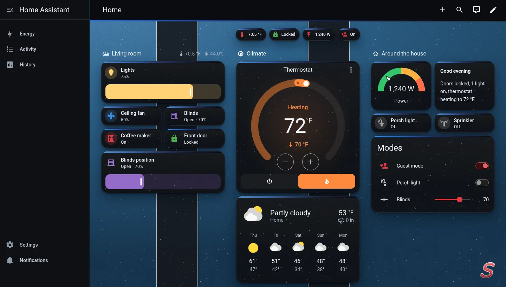

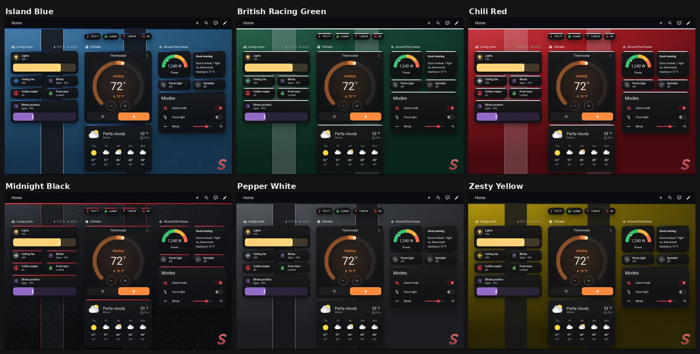

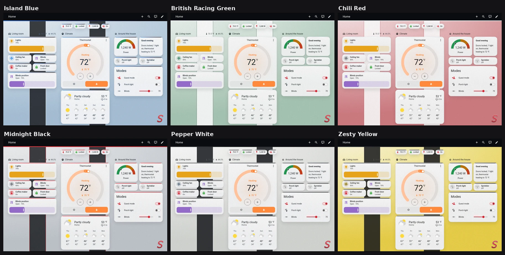

<details>
<summary>Each colourway at full size</summary>

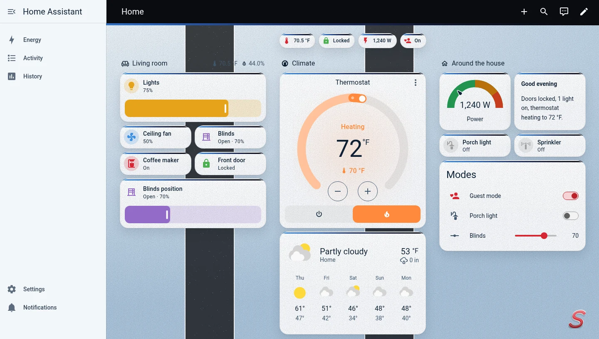
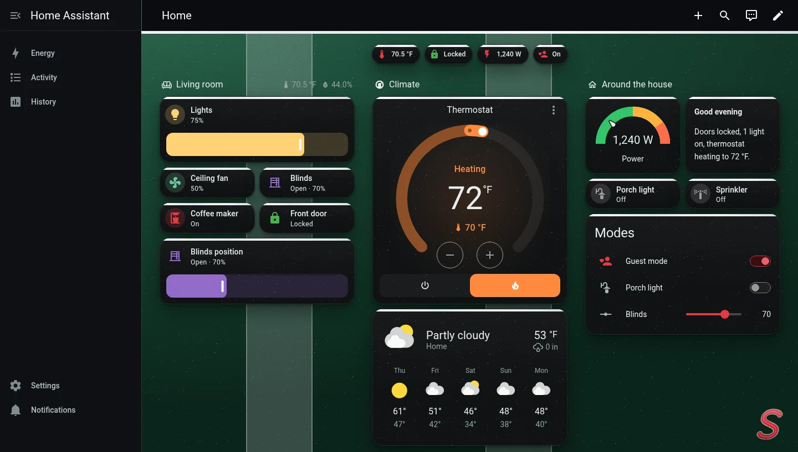
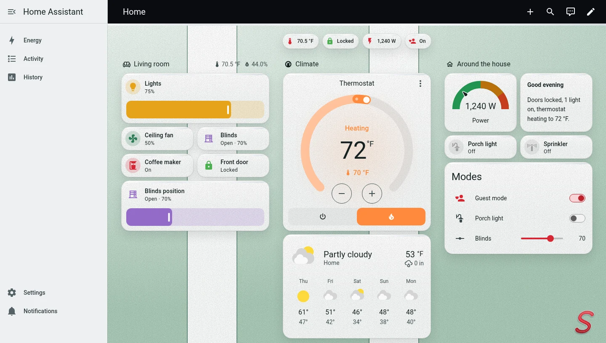
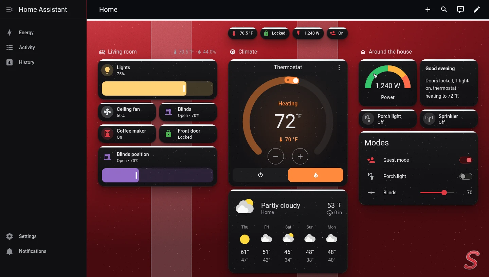
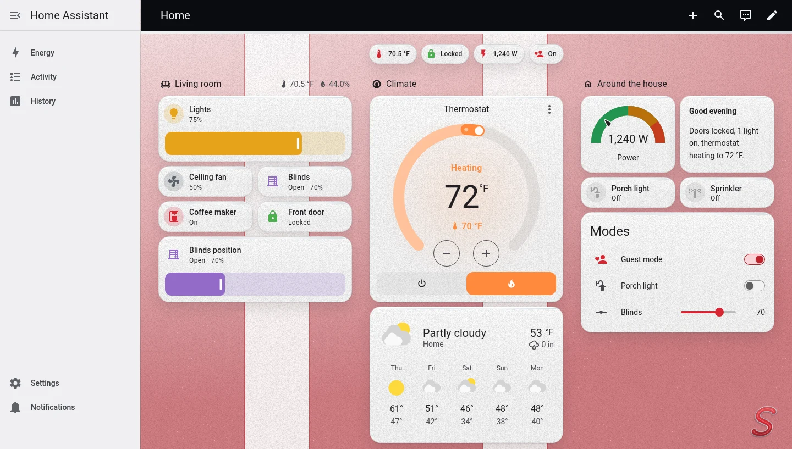
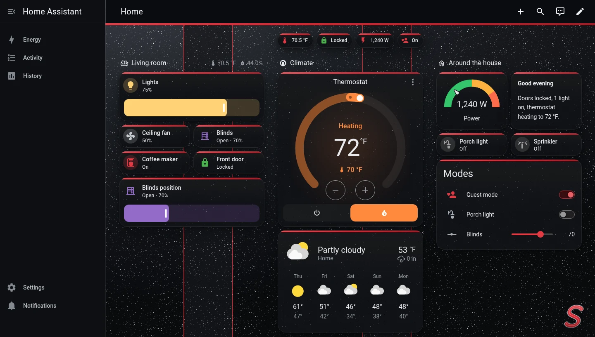
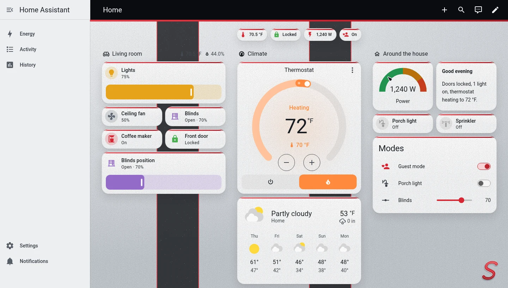
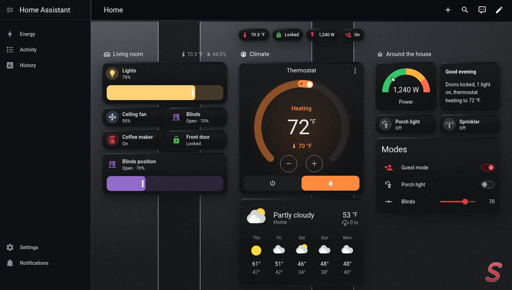
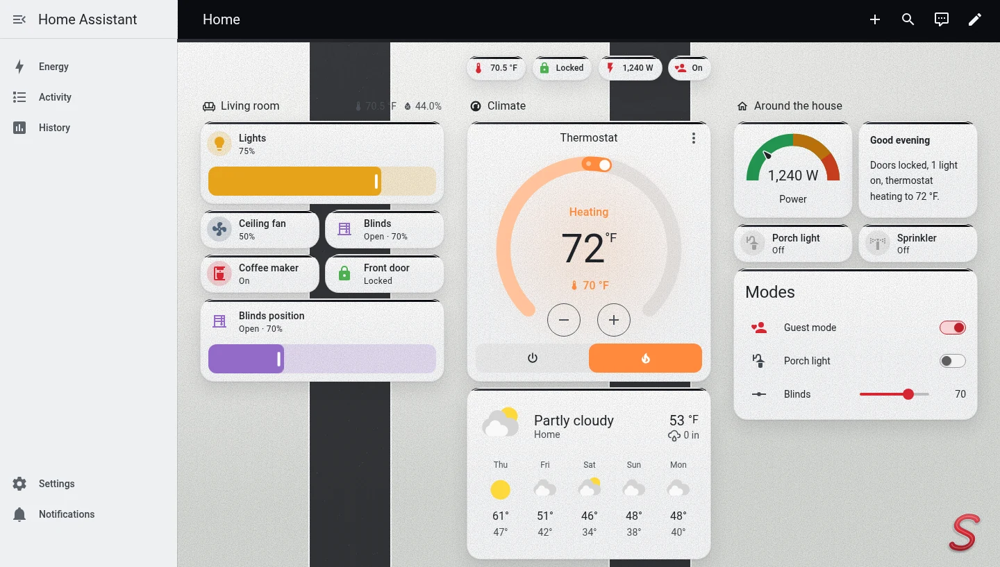
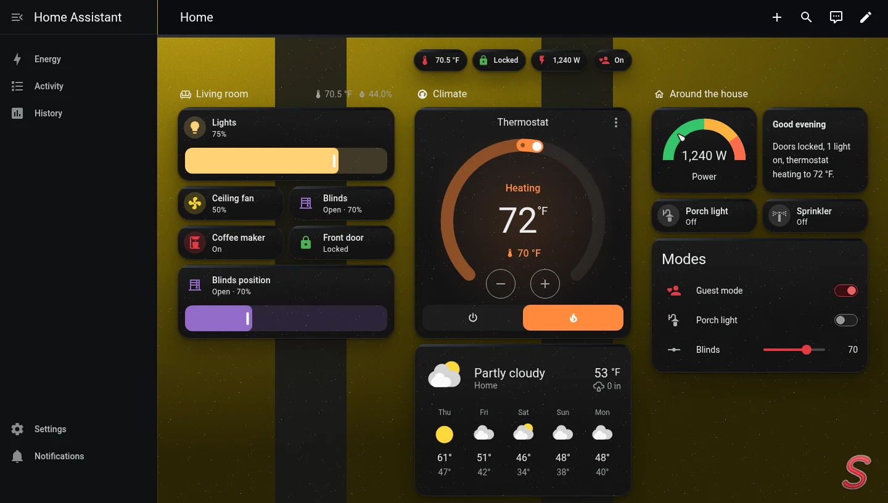
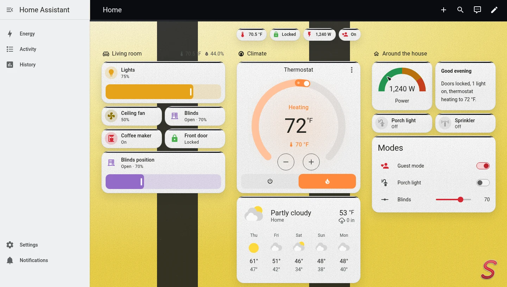

</details>

## Themes

| Theme | Paint | Roof | Bonnet stripes |
|---|---|---|---|
| **Mini Cooper S** | Island Blue | Multitone (blue fading to black) | black, white pinstripe |
| **Mini Cooper S British Racing Green** | British Racing Green | white | white |
| **Mini Cooper S Chili Red** | Chili Red | white | white |
| **Mini Cooper S Midnight Black** | Midnight Black | Chili Red | black, red pinstripe |
| **Mini Cooper S Pepper White** | Pepper White | black | black |
| **Mini Cooper S Zesty Yellow** | Zesty Yellow | black | black |

Every colourway has light and dark modes and follows your light/dark setting. The Chili Red S is the "on" colour in
all of them, as it's on the grille of every Cooper S. The paint colours are matched by eye from photos; they aren't
official paint codes.

## Design

| On the car | In the theme |
|---|---|
| Metallic paint | The page: a sheen of the paint colour with metallic flake |
| The roof (or the Multitone fade, bright blue at the windshield to Jet Black) | A band under the header and a strip along the top of every card |
| Bonnet stripes and pinstripes | Two stripes down the page, like looking over the bonnet |
| Chili Red S on the grille | The primary colour for anything that's on, and an S badge in the bottom-right corner |
| Jet Black roof and piano-black trim | The header and sidebar, and the cards in dark mode |
| Round LED headlights | Rounder, 20 px cards |

Light mode uses a pale wash of the paint with pearl cards; dark mode is the paint at night with piano-black cards.
Error colours are orange-red, so they read apart from the S red.

It's plain theme variables: no card-mod or other add-ons needed. The flake and the badge are SVGs embedded in the
theme file, so there's nothing to copy into `www/`.

## Installation

### HACS

1. HACS → ⋮ → **Custom repositories**. Add `https://github.com/edwork/mini-cooper-s-theme` with type **Theme**.
2. Search for **Mini Cooper S**, then **Download**.
3. Run the **Home Assistant Frontend: Reload themes** action (`frontend.reload_themes`), or restart.

### Manual

Copy [`themes/mini_cooper_s.yaml`](themes/mini_cooper_s.yaml) into your `config/themes/` folder, then reload themes.

Either way, your `configuration.yaml` needs to load themes from that folder:

```yaml
frontend:
  themes: !include_dir_merge_named themes
```

## Usage

- **Your profile:** your user (bottom left) → **Theme** → any of the six. They follow your light/dark setting.
- **One view:** edit the view → **Theme**, or `theme: Mini Cooper S Chili Red` in YAML. A view theme styles the view's
  content; the header and sidebar keep your profile theme.

## Customising

`themes/mini_cooper_s.yaml` is generated, so don't edit it by hand. Each colourway is a row in the `SCHEMES` table in
[`tools/build_theme.py`](tools/build_theme.py): paint shades for each mode, roof, stripe and pinstripe colours, accent
and flake. Add your own car's paint there and run:

```sh
python3 tools/build_theme.py            # regenerate themes/mini_cooper_s.yaml
python3 tools/build_theme.py --check    # what CI runs: fails if the YAML is out of date
```

It needs only Python 3.9+ and the standard library.

## Credits

MINI and Cooper S are trademarks of BMW AG. This is an unofficial fan project and isn't affiliated with or endorsed
by BMW or MINI.

## License

[MIT](LICENSE)
